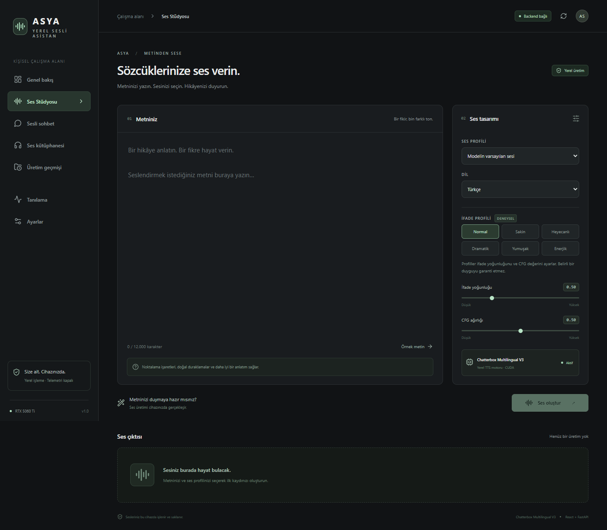
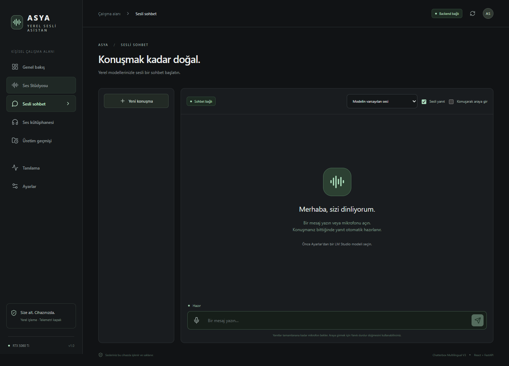

<div align="center">

# 🎙️ ASYA

**Yerel çalışan, Türkçe destekli sesli yapay zekâ asistanı**


Ses üretimi · Referans ses profilleri · Streaming sesli sohbet

[Kurulum](KURULUM.md) · [Katkıda bulunma](CONTRIBUTING.md) · [Lisans](LICENSE)

</div>

## Uygulamadan görüntüler

### Ses Stüdyosu



### Sesli sohbet



Görüntüler gerçek ASYA arayüzünden, boş bir demo veri alanıyla alınmıştır.
Kişisel konuşmalar veya ses kayıtları içermez; üretilmiş bir yanıt göstermez.

## ASYA ile neler yapabilirsiniz?

| Özellik | Nasıl çalışır? |
| --- | --- |
| Metinden ses | Chatterbox ile yerel ses üretimi, dil ve ifade ayarları |
| Referans ses profilleri | Kullanım izni bulunan kayıtlarla ses kütüphanesi |
| Sesli sohbet | Tarayıcı mikrofonu → Whisper → LM Studio → Chatterbox |
| Akış halinde yanıt | LLM yanıtı sürerken tamamlanan ifadelerin seslendirilmesi |
| Konuşma kontrolü | Yanıtı durdurma, isteğe bağlı konuşarak araya girme ve tempo ayarı |
| Kalıcılık | SQLite üzerinde konuşmalar, ayarlar ve üretim geçmişi |
| Ses çıktıları | WAV/MP3 indirme, geçmişi dinleme ve karşılaştırma |
| Tanılama | İş durumu, hata kayıtları ve GPU bilgileri |
| Yerel ağ | İsteğe bağlı HTTPS ile aynı ağdaki cihazlardan erişim |

İfade ayarları model parametrelerini değiştirir; belirli bir duyguyu veya kahkaha/ağlama
üretimini garanti etmez. Chatterbox her ses parçasını tamamladıktan sonra oynatma başlar.

## Hızlı başlangıç

Mevcut Python/CUDA ortamı hazırlanmış bir Windows bilgisayarda, repo kökünden:

```powershell
.\scripts\start-app.ps1
```

Tarayıcı: **http://127.0.0.1:8000**. LM Studio'da yerel API sunucusunu başlatın,
bir sohbet modeli yükleyin ve ASYA'nın Ayarlar ekranından adres/model seçin.

Yeni kuruluma veya mevcut `voice-lab` ortamını bağlamaya başlamadan önce
[Kurulum rehberini](KURULUM.md) okuyun. `pip install -r requirements.txt` tek başına
CUDA, Chatterbox, model ağırlıkları ve frontend kurulumunu tamamlamaz.

> **Geçiş durumu:** Yeni sürüm `evolution/voice-studio` dalına parça parça
> aktarılıyor. Frontend ve başlatıcılar ayrı commitlerdir; bu komutlar ilgili
> dosyaların bulunduğu tam çalışma kopyası içindir. Sıfırdan temiz AI ortamı
> kurulumu henüz doğrulanmış değildir.

## Mimari

```text
Tarayıcı / React
  ├─ Mikrofon ve ses oynatma
  └─ HTTP / WebSocket
       └─ FastAPI
            ├─ SQLite: ayarlar, konuşmalar ve işler
            ├─ LM Studio: yerel LLM, streaming yanıt
            └─ GPU kuyruğu
                 ├─ Chatterbox: metinden ses
                 └─ İzole Whisper worker: konuşma tanıma
```

```text
apps/backend/       API, ses motorları, kalıcılık ve backend testleri
apps/frontend/      ASYA arayüzü ve frontend/tarayıcı testleri
scripts/            Başlatma, ortam kontrolü ve doğrulama araçları
docs/               Mimari notları ve OpenAPI sözleşmesi
images/             README ekran görüntüleri
data/               Yerel kullanıcı verileri ve modeller; Git dışında
```

## Gereksinimler ve kapsam

- Windows üzerinde Python 3.11 ve Node.js >=22.12.0.
- GPU kullanımı için uyumlu NVIDIA/CUDA/Torch ortamı. Mevcut doğrulama RTX 5060 Ti
  16 GB ve Torch 2.10.0+cu128 ortamında yapılmıştır; bu bir minimum donanım garantisi değildir.
- Sesli asistan için çalışan LM Studio sunucusu ve yüklenmiş bir sohbet modeli.
- Whisper için ana Python ortamından ayrı `.venv-stt` ortamı.
- LAN HTTPS kurulumu için PowerShell 7 ve istemci cihazında yerel CA güveni.

Yeni sürümün macOS/Linux çalışması, fiziksel mikrofon/oda yankısı ve sıfırdan
kurulum bu aktarımda doğrulanmadı. Masaüstü Tauri/Electron paketi ve Fish S2
entegrasyonu henüz tamamlanmadı.

## Gizlilik ve yerel çalışma

Ses motorları yerel çalışır. İlk paket/model indirmeleri internet gerektirir;
offline mod mevcut model önbelleklerini kullanır. LM Studio ayrı bir süreçtir.

Konuşmalar, referans sesler, üretimler, modeller ve sertifikalar `data/` altında
saklanır ve Git'e eklenmez. LAN modu açılırsa aynı ağdaki cihazlar uygulamanın
kayıtlarına erişebilir; güvenilen bir ağda kullanın.

## Geliştirme ve test

Hazırlanmış ortamda:

```powershell
.\scripts\test.ps1
```

Bu komut backend testlerini, frontend testlerini ve production derlemesini çalıştırır.
Gerçek GPU/model ve tarayıcı doğrulamaları ayrı araçlarla yapılır. Aktarım sırasında
60 backend ve 10 frontend testi ile production derlemesi başarılıydı; bunlar fiziksel
mikrofon veya sıfırdan kurulum doğrulaması anlamına gelmez.

## Önceki ASYA sürümü

ASYA aynı repository ve Git geçmişiyle devam eder. Yeni uygulamanın kullanmadığı
Streamlit/Ollama/Edge-TTS kök modülleri ve eski kurulum araçları kaldırılmıştır.
[Önceki sürümün kaynakları ve README'si](https://github.com/emir01b/asya-ai-assistant/tree/9205f79c5a61d2745814dd105e0933270e73d2a2)
Git geçmişinde bulunur. `images/resim1.png` ve `images/resim2.png` eski sürümün
arşiv görselleridir. Eski SQLite konuşmalarını yeni şemaya aktaran dönüştürücü henüz yoktur.

## Lisans

ASYA kaynakları [MIT](LICENSE) lisanslıdır. Chatterbox, Whisper, model ağırlıkları
ve diğer bağımlılıklar kendi lisans koşullarına tabidir.
